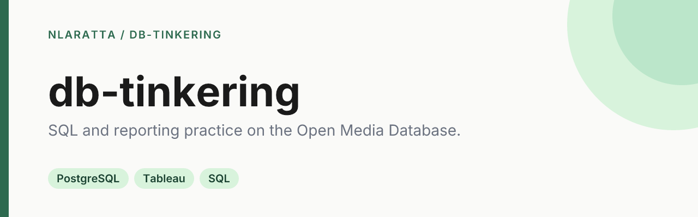
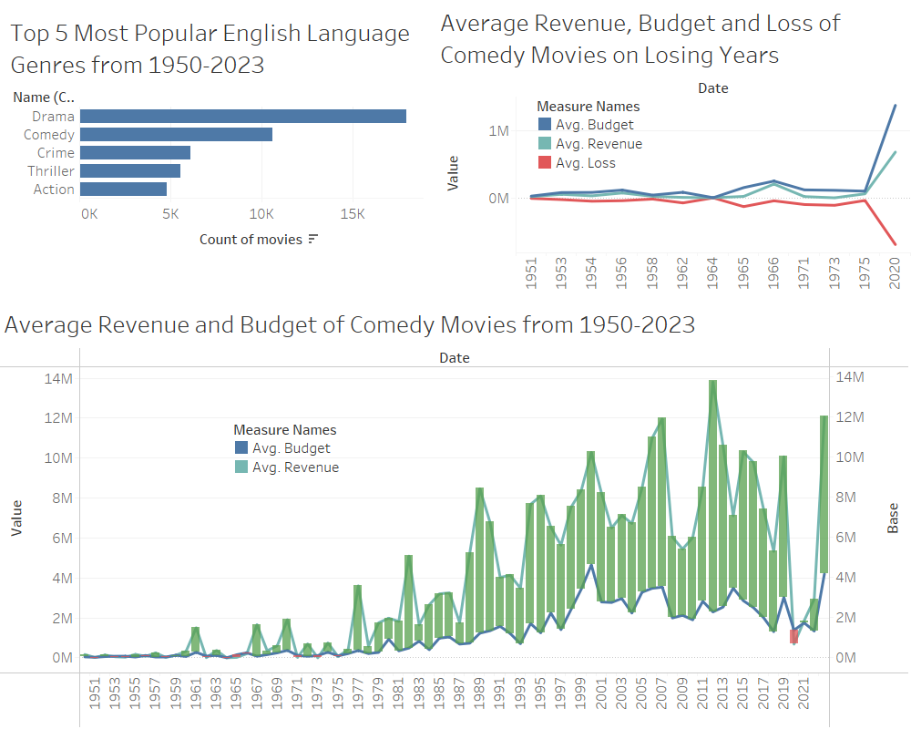
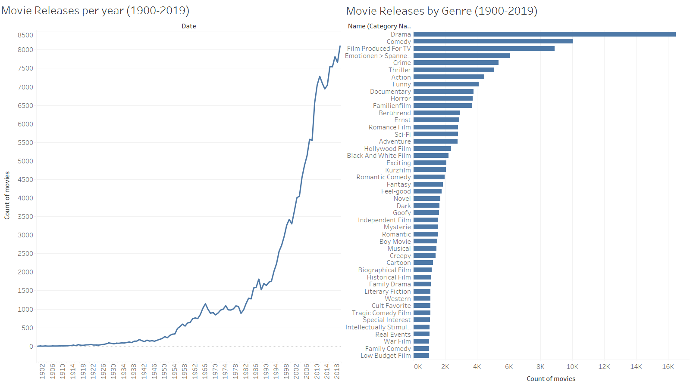

<p align="center">
  
</p>

<p align="center">
  <a href="https://github.com/nlaratta/db-tinkering/actions/workflows/ci.yml"></a>
  <a href="LICENSE"></a>
</p>

A place to practice SQL and reporting. It runs the [Open Media Database](https://www.omdb.org/content/About) (about 210k movies) in PostgreSQL, explores it with SQL, and builds Tableau dashboards on top of it.

<p align="center">
  
  
</p>

## Quick start

You need Docker (or any Postgres 15+) and the Postgres client tools (`brew install libpq` on macOS).

```bash
git clone https://github.com/nlaratta/db-tinkering.git
cd db-tinkering

# Throwaway Postgres on localhost:5432
docker run -d --name omdb -e POSTGRES_PASSWORD=postgres -p 5432:5432 postgres:17
export PGHOST=localhost PGUSER=postgres PGPASSWORD=postgres

# Download the snapshot (36 MB, from this repo's releases) and restore it
./scripts/restore.sh

# Try a query
psql -d omdb -f queries/02-releases-by-genre.sql
```

To open the dashboards, load `omdb.twb` in Tableau Desktop. It connects to the `omdb` database on `localhost:5432` as `postgres`.

## What's here

| Path | What it is |
|---|---|
| `queries/` | SQL behind the dashboard views: releases per year, releases by genre, and comedy budget vs revenue by year |
| `omdb.twb` | Tableau workbook with both dashboards |
| `scripts/restore.sh` | Downloads the [`omdb-2025-02`](https://github.com/nlaratta/db-tinkering/releases/tag/omdb-2025-02) `pg_dump` snapshot and restores it |
| `docs/` | Dashboard screenshots |

The queries approximate the charts. Tableau averaged in movies with no budget or revenue recorded, while the SQL leaves those out.

CI restores the snapshot into a fresh Postgres 17 and runs every query on each push.

## Data

The data is from the [Open Media Database](https://www.omdb.org/), loaded into Postgres with [df7cb/omdb-postgresql](https://github.com/df7cb/omdb-postgresql). OMDb data is published under a Creative Commons license. See [omdb.org](https://www.omdb.org/content/About) for terms. To build a fresh copy instead of using the snapshot, follow the omdb-postgresql README.

## License

The SQL, scripts and workbook are [MIT](LICENSE) © Noah Laratta. The OMDb data keeps its original license.
